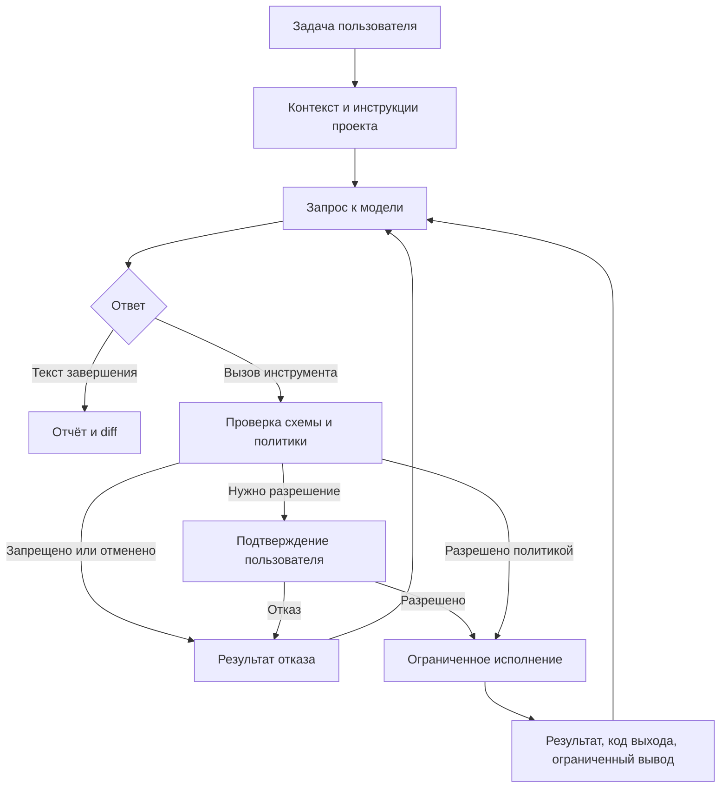

# Архитектура Lyra

Статус: CLI/doctor и локальный CPU inference реализованы; цикл кодинг-агента проектируется.
Требование пользователя от 2026-10-30: AI работает локально на ресурсах ПК,
без обязательного внешнего сервиса. Оно заменяет первоначальный OpenAI-first план.

## Выбор языка и платформы

| Вариант | Сильные стороны для задачи | Компромисс |
| --- | --- | --- |
| **Rust — выбран** | Нативный CLI, контроль памяти, безопасная работа с конкурентностью, Windows API через FFI. | Более сложная реализация; интеграции с AI API нужно проверять отдельно. |
| Go | Простой CLI и конкурентная работа с сетью, удобная сборка. | Сборщик мусора; иной контроль памяти и нативных границ. |
| C# / .NET | Сильная экосистема Windows, удобный путь к desktop UI. | Управляемый runtime либо ограничения Native AOT; приоритет сейчас у CLI. |
| TypeScript / Python | Быстрый прототип и развитые AI-интеграции. | Дополнительный runtime или упаковка; меньше контроля локальных ресурсов. |

Выбор Rust соответствует приоритету эффективного локального приложения.
Он не гарантирует выигрыш в скорости ответа модели. Первый target —
`x86_64-pc-windows-msvc`, Windows 11, обычные права пользователя.
Linux полезен для переносимой логики и CI; Windows остаётся обязательной
платформой приёмки. Поддержка Windows 10 и ARM64 пока не заявлена.

## Границы компонентов

В первом Cargo-проекте достаточно одного crate с модулями по потребности.
Разделение на workspace crates выполняется при реальной необходимости.
Следующая таблица описывает ответственности, а не существующие каталоги.

| Компонент | Ответственность |
| --- | --- |
| CLI | Аргументы, вывод событий, запрос разрешения, отмена. |
| Agent core | Состояние задачи, цикл запросов, лимиты и итоговый отчёт. |
| Context | Поиск и чтение кода, применимые инструкции, отбор файлов и лимит контекста. |
| Inference | Локальные веса, CPU/GPU backend, токенизация, генерация и отмена. |
| Tools | Типизированные чтение, поиск, патч, Git diff и запуск разрешённых команд. |
| Policy / executor | Решение о доступе и фактическое исполнение с границами ОС. |
| Session | Ограниченная история и диагностика без секретов; сохранение позже. |

Текущий один crate: `src/main.rs` — коды выхода, `src/lib.rs` — CLI,
`src/doctor.rs` — одноразовая диагностика через `sysinfo`.
`clap` разбирает аргументы; `serde`/`serde_json` формируют JSON. `Cargo.lock`
закрепляет зависимости. Нет HTTP-клиента, фонового сервиса и собственного unsafe.
Не собираются списки процессов, пользователей и сетевых интерфейсов.

## Цикл агента

Лимиты числа шагов, времени, контекста, вывода и сетевых повторов задаются
до начала цикла. Исчерпание лимита или отмена завершает работу с понятным
частичным результатом. Отказ инструмента не даёт модели новых полномочий.

## Первый inference: локальные веса

M2 должен загружать GGUF с явного локального пути, выполнять inference на CPU
и, при доступном backend, GPU. Выбран llama.cpp через `llama-cpp-2 =0.1.160`, со встроенной статической
CPU-библиотекой и явным feature `cuda`. Собственный unsafe в Lyra запрещён;
FFI реализован зависимостью, её обновления требуют отдельной проверки.
Не требовать установленного Ollama, облачного API или отдельного сервера.
Не включать скачивание весов, телеметрию и отправку кода автоматически.

Модель и параметры задаются явно: контекст, число потоков, GPU-offload и лимиты
генерации. Выбор по RAM/VRAM — оценка, затем обязательная проверка реальной
загрузкой. Не менять модель или backend молча при нехватке памяти.
Обрабатывать неверный GGUF, OOM, несовместимость backend и отмену без потери
пользовательских данных. Потоковая генерация не блокирует отмену.

Схемы будущих tool calls проверяются в приложении. Текст модели не исполняется
как shell-код; выбранная модель должна отдельно пройти сценарии вызова инструментов.
Наличие модели для генерации текста не доказывает готовность кодинг-агента.
Оценка памяти и исходный кандидат — в [локальных моделях](LOCAL_MODELS.md).

## Границы доверия и доступа

Режим анализа по умолчанию читает только разрешённые файлы выбранного проекта;
контекст обрабатывается локально и не передаётся внешнему провайдеру.
Нужны исключения секретов, проверка разрешённых путей и ограничения объёма.
Режим редактирования даёт запись в рабочую область по политике сессии.
Политика подтверждения учитывает уже выданное разрешение и не спрашивает
повторно для того же разрешённого объёма. Изменение политики требует явного действия пользователя.

Разрешение запускать shell не означает, что команда ограничена каталогом проекта.
До включения команд модели требуется отдельное решение по изоляции Windows:
файловая система, сеть, дерево процессов и запрет неявного повышения прав.
При отсутствии требуемой изоляции исполнение запрещается с понятной причиной;
временный режим без sandbox не включается автоматически. Конкретный механизм
и минимальная версия Windows для него — открытое решение этапа M3.

`AGENTS.md` целевого проекта влияет на рабочий процесс, но не выдаёт доступ
к секретам, другим каталогам или сети. Патчи проверяют исходное содержимое,
пути и конкурирующие изменения. Junction/symlink, race при проверке пути и
наследование доступа дочерними процессами требуют отдельных сценариев приёмки.

## Эффективность и расширение

Контекст собирается выборочно с исключением `.git`, сборок и двоичных файлов;
не предполагается полная индексация при каждом сообщении. Нет фонового сервиса,
постоянного опроса. Локальная LLM обязательна для MVP; CPU backend должен
сохранять возможность запуска без GPU, а пригодность по скорости измеряется.

Для дальнейшего роста можно изучить структурный индекс и инкрементальное
обновление по примеру Understand-Anything. Проверенные связи и выводы модели
должны храниться раздельно с привязкой к исходнику/ревизии. Изменение содержимого
инвалидирует связанные поведенческие выводы даже при прежних сигнатурах.
Неполный индекс не доказывает отсутствие использования или безопасность удаления.
Решение об индексе принимается после измерения поиска и контекста первого MVP.

GUI, TUI, другие локальные backend и MCP в будущем используют те же контракты ядра
и политики доступа. Не создавать их инфраструктуру заранее.
Критерии измерений и проверки — в [руководстве разработчика](DEVELOPMENT.md),
основания решений — в [источниках](REFERENCES.md).

## Тестируемая alpha и роли

`task` реализует ограниченный цикл JSON-действий: list/read_file/search,
propose_edit/finish. Native sampler ограничен GBNF; serde отклоняет неизвестные
инструменты/поля. Инструментальные права проверяет приложение.
Изменения остаются предложениями до отдельного `apply --index`.

`--subagents` включает pipeline researcher → coder → reviewer. У каждого новая
история/контекст; исследователь/ревьюер read-only, рекурсии нет. Общий бюджет
по умолчанию 12 вызовов: до 3/6/3 соответственно; неиспользованные шаги не означают
дополнительную квоту. Веса и backend загружаются один раз, KV-context каждой
роли освобождается перед следующим запросом. Многопоточность CPU внутри native
inference не равна параллельному запуску ролей.

Rust отвечает за CLI, права, бюджеты, контекст и оркестратор. C/C++ уже используется
для inference; Python — для инфраструктуры сборки. Другие языки допустимы по
обоснованной необходимости; добавление runtime само по себе не повышает эффективность.
Сравнивать нужно время задачи, память и правильность проверенного результата.

Файловый доступ выполняется через cap-std directory capability, с фильтрами путей,
root/nested gitignore и отказом symlink/reparse points. Это не process sandbox.
`apply` проверяет исходное содержимое, готовит временный файл в том же корне
и заменяет один файл. Полная multi-file транзакция/атомарный compare-and-swap
с внешними редакторами не заявляются; alpha проверять в изолированной копии.

Постоянные инструкции worker передаются отдельным system-сообщением, данные проекта — user-сообщением. Грамматика содержит только выбранные пути; read-only worker не получает ветку propose_edit. Проверки прав в контроллере остаются независимыми от грамматики и следования инструкциям моделью.

## Настольный интерфейс

Optional feature `desktop` добавляет eframe/egui и rfd. Rust-окно не содержит
отдельной политики доступа: оно запускает себя как `--worker task/apply/doctor`,
передаёт аргументы напрямую без shell и использует текущий CLI-движок.
Одна задача одновременно; вывод ограничен, окно не держит веса. Отмена/закрытие
завершает task-worker и освобождает модель; apply дожидается завершения записи.
Приватный временный каталог принадлежит job и очищается после завершения процесса
и чтения pipes. Без автоматического сохранения истории или телеметрии.
wgpu/OpenGL обслуживает только окно; ускорение inference CUDA по-прежнему отдельно.
