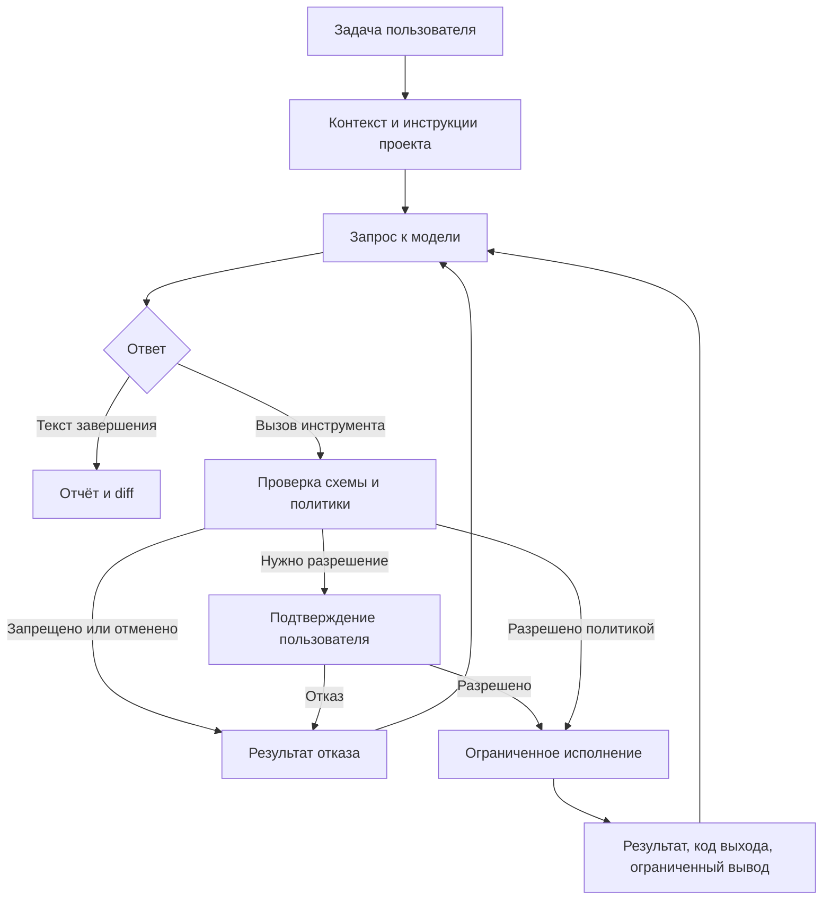

# Архитектура Lyra

Статус: исходное решение для будущего MVP; runtime ещё не реализован.

## Выбор языка и платформы

| Вариант | Сильные стороны для задачи | Компромисс |
| --- | --- | --- |
| **Rust — выбран** | Нативный CLI, контроль памяти, безопасная работа с конкурентностью, Windows API через FFI. | Более сложная реализация; интеграции с AI API нужно проверять отдельно. |
| Go | Простой CLI и конкурентная работа с сетью, удобная сборка. | Сборщик мусора; иной контроль памяти и нативных границ. |
| C# / .NET | Сильная экосистема Windows, удобный путь к desktop UI. | Управляемый runtime либо ограничения Native AOT; приоритет сейчас у CLI. |
| TypeScript / Python | Быстрый прототип и развитые AI-интеграции. | Дополнительный runtime или упаковка; меньше контроля локальных ресурсов. |

Выбор Rust соответствует приоритету эффективного локального приложения.
Он не гарантирует выигрыш в скорости ответа модели. Первый target —
`x86_64-pc-windows-msvc`, Windows 11, обычные права пользователя.
Linux полезен для переносимой логики и CI; Windows остаётся обязательной
платформой приёмки. Поддержка Windows 10 и ARM64 пока не заявлена.

## Границы компонентов

В первом Cargo-проекте достаточно одного crate с модулями по потребности.
Разделение на workspace crates выполняется при реальной необходимости.
Следующая таблица описывает ответственности, а не существующие каталоги.

| Компонент | Ответственность |
| --- | --- |
| CLI | Аргументы, вывод событий, запрос разрешения, отмена. |
| Agent core | Состояние задачи, цикл запросов, лимиты и итоговый отчёт. |
| Context | Поиск и чтение кода, применимые инструкции, отбор файлов и лимит контекста. |
| Provider | Авторизация, запросы/ответы OpenAI, потоковые события, ошибки и usage. |
| Tools | Типизированные чтение, поиск, патч, Git diff и запуск разрешённых команд. |
| Policy / executor | Решение о доступе и фактическое исполнение с границами ОС. |
| Session | Ограниченная история и диагностика без секретов; сохранение позже. |

Для сети и async-кода кандидаты — `reqwest`, `tokio`, `serde`.
Зависимости и версии ещё не выбраны. Перед добавлением проверить MSVC,
лицензии, TLS, поддержку proxy/CA и нужный минимум features.
Не отключать проверку сертификатов ради работоспособности.

## Цикл агента

Лимиты числа шагов, времени, контекста, вывода и сетевых повторов задаются
до начала цикла. Исчерпание лимита или отмена завершает работу с понятным
частичным результатом. Отказ инструмента не даёт модели новых полномочий.

## Первый провайдер: OpenAI

Исходный вариант — прямой HTTPS-адаптер к Responses API. Выбор SDK допустим
после проверки его актуальности и поддержки нужного протокола в Rust.
Идентификатор модели и поддерживаемые возможности должны быть явной конфигурацией.
Не привязывать ядро к названию одной модели и не подменять её автоматически.

Проверять схемы tool calls, сохранять идентификаторы вызовов и соответствие
результатов. Строгая схема не заменяет проверку прав и значений аргументов.
Потоковые аргументы исполнять только после полного получения и валидации.
Сохранять необходимые элементы состояния ответа по актуальному контракту API;
не ограничиваться извлечением одного текстового поля.

Отдельно обрабатывать ошибки авторизации, ограничения частоты, недоступность
сети, повреждённый поток и отмену. Повтор сетевого запроса не должен повторно
исполнять уже выполненную локальную команду. API-ключ передавать через окружение
или защищённое хранилище; в проектные конфиги и логи он не попадает.
Возможность стороннего клиента использовать подписку ChatGPT не предполагается:
способ авторизации и биллинга проверяется отдельно по официальной документации.

## Границы доверия и доступа

Режим анализа по умолчанию читает только разрешённые файлы выбранного проекта;
передача контекста внешнему провайдеру требует явно настроенного подключения.
Нужны исключения секретов, проверка разрешённых путей и ограничения объёма.
Режим редактирования даёт запись в рабочую область по политике сессии.
Политика подтверждения учитывает уже выданное разрешение и не спрашивает
повторно для того же разрешённого объёма. Изменение политики требует явного действия пользователя.

Разрешение запускать shell не означает, что команда ограничена каталогом проекта.
До включения команд модели требуется отдельное решение по изоляции Windows:
файловая система, сеть, дерево процессов и запрет неявного повышения прав.
При отсутствии требуемой изоляции исполнение запрещается с понятной причиной;
временный режим без sandbox не включается автоматически. Конкретный механизм
и минимальная версия Windows для него — открытое решение этапа M3.

`AGENTS.md` целевого проекта влияет на рабочий процесс, но не выдаёт доступ
к секретам, другим каталогам или сети. Патчи проверяют исходное содержимое,
пути и конкурирующие изменения. Junction/symlink, race при проверке пути и
наследование доступа дочерними процессами требуют отдельных сценариев приёмки.

## Эффективность и расширение

Контекст собирается выборочно с исключением `.git`, сборок и двоичных файлов;
не предполагается полная индексация при каждом сообщении. Нет фонового сервиса,
постоянного опроса или обязательного GPU. Локальная LLM не входит в MVP.

Для дальнейшего роста можно изучить структурный индекс и инкрементальное
обновление по примеру Understand-Anything. Проверенные связи и выводы модели
должны храниться раздельно с привязкой к исходнику/ревизии. Изменение содержимого
инвалидирует связанные поведенческие выводы даже при прежних сигнатурах.
Неполный индекс не доказывает отсутствие использования или безопасность удаления.
Решение об индексе принимается после измерения поиска и контекста первого MVP.

GUI, TUI, другие провайдеры и MCP в будущем используют те же контракты ядра
и политики доступа. Не создавать их инфраструктуру заранее.
Критерии измерений и проверки — в [руководстве разработчика](DEVELOPMENT.md),
основания решений — в [источниках](REFERENCES.md).
