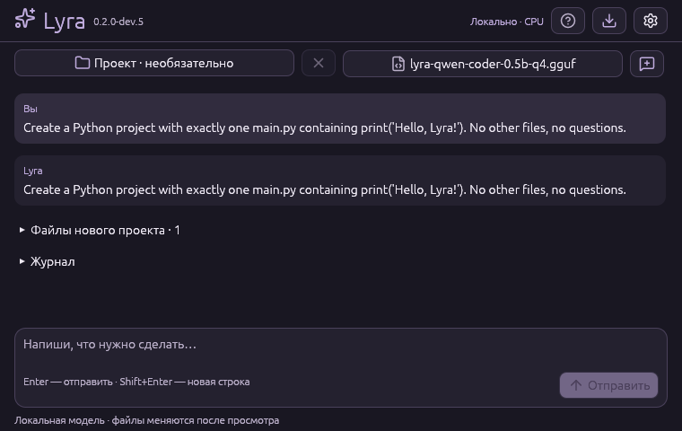

# Компактная настольная Lyra · 0.2.0-dev.5

## Запуск Windows

Скачайте `lyra-x86_64-pc-windows-msvc` успешного запуска
[GitHub Actions](https://github.com/DraimCiDo/Lyra/actions/workflows/ci.yml)
ветки **`main`**, распакуйте ZIP и откройте `lyra-desktop.exe`.
Rust, Python, Node, браузер и соседний CLI для запуска не нужны.
Требуется [Microsoft Visual C++ v14 x64 Runtime](https://aka.ms/vc14/vc_redist.x64.exe)
и заранее подготовленная instruction-модель GGUF. Модель и DLL runtime не входят
в ZIP. Это portable CPU alpha; CUDA и качество 7B на пользовательском ПК не приняты.
Установщика и подписи кода пока нет. Обновления из приложения описаны в [UPDATES.md](UPDATES.md).

## Главное окно

Размер по умолчанию — **760×480**, минимальный — **640×460** логических пикселей.
Окно можно увеличить для чтения кода. Компоновка следует ReplayLite: мягкие
карточки, скруглённые поля/кнопки, шестерёнка, стрелка назад, разделы с иконками.

1. Выберите **GGUF**, а существующий **проект** — при необходимости.
   Без выбранной папки чат готовит новый проект. × снимает выбор и очищает контекст.
2. Напишите сообщение и нажмите **«Отправить»** или Enter; Shift+Enter — новая строка.
   Отвечайте на уточнения следующим сообщением. Окно остаётся отзывчивым;
   **«Остановить»** завершает worker. Закрытие окна также останавливает task.
3. В **«Файлах и предложениях»** под ответом выберите файл, просмотрите код,
   нажмите **«Применить…»** и подтвердите имя файла. При конфликте исходника
   запись отклоняется. Применяется одно выбранное предложение.
4. Для нового проекта просмотрите план и нажмите **«Создать проект…»**: место
   выбирается после ответа, отдельного мастера нет. Запустите тесты отдельно.

Кнопка сохранения у предложений экспортирует JSON вручную. **«Журнал»** содержит
последние 64 KiB stderr после завершения задачи. Пока worker активен, чат показывает
статус; токены модели пока не передаются в UI потоком. Отчёт привязан к исходной
папке проекта. Apply не прерывается посередине
записи: при закрытии окна программа дожидается его завершения.

Переписка хранится только в RAM: до 32 сообщений и 256 KiB текста. Контекст
одного запроса ограничен 16 KiB и дополнительно реальным token window модели;
при переполнении предлагается новый чат, история не обрезается молча.
Смена проекта очищает переписку и предложения. «Новый чат» оставляет выбранную
модель и папку. Каждое сообщение запускает отдельный worker/загрузку GGUF;
постоянного model server пока нет. Документы и код не сохраняются в preferences.



Снимок реального Linux/CPU smoke с Qwen2.5-Coder 0.5B Q4: сообщение отправлено
через Enter, получен blueprint с main.py. Это проверка механики UI, не качества
веб-дизайна или 7B. Просмотр файлов свёрнут по умолчанию; создание ещё не выполнялось.

## Настройки

Шестерёнка открывает отдельный экран, стрелка возвращает к задаче.
Разделы обозначены Lucide-иконками с подсказками:

| Раздел | Настройки |
| --- | --- |
| Модель и ресурсы | Контекст из готовых размеров; ползунки токенов, CPU-потоков и таймаута; числовые значения можно редактировать точно. |
| Контекст проекта | До 32 относительных путей по одному на строке. Пусто — ограниченный индекс; исключения проверяет движок. |
| Помощники | Переключатель исследователя/ревьюера и общий лимит вызовов. Роли последовательны, с одной моделью и раздельными историями. |
| Оформление | Мята, Океан, Лаванда, Светлая; RU/EN; отключение мягких анимаций. |
| Мой компьютер | Диагностика текущего ПК по кнопке, без автоматической отправки/сохранения отчёта. |

Тема/язык меняются сразу, без перезапуска модели. Ответы модели и сообщения
движка показываются в исходном виде, без машинного перевода.
Анимации ограничены переходами/переключателями (~140 ms); в покое нет постоянного
таймера перерисовки. Для активной задачи UI обновляется через 250 ms, в свёрнутом
окне этот UI-таймер не запрашивается. Кнопка отключения анимаций действует на UI.

Начальные параметры: context 4096, ответ 512 токенов, 12 вызовов, timeout 600 s,
CPU threads — доступный параллелизм с максимумом 8. Дополнительные роли могут
увеличить время задачи; ускорение не обещается. Сброс числовых параметров
сохраняет выбранные пути, список файлов, язык, тему и переключатели.

## Локальное сохранение

Параметры, тема, язык, список путей контекста и выбранные проект/GGUF сохраняются:

- Windows: `%APPDATA%\Lyra\settings.json`.
- Linux: `$XDG_CONFIG_HOME/lyra/settings.json` или `~/.config/lyra/settings.json`.

Размер файла ограничен 64 KiB; значения проверяются. Запись выполняется через
временный файл при изменении, после отпускания ползунка/короткой задержки,
а не каждый кадр. Ошибка чтения/сохранения показывается в настройках.
**Текст задачи, исходный код, ответы модели, история и журнал не сохраняются
автоматически.** Экспорт JSON содержит пути и код и выполняется явно.
Временное задание/отчёт worker удаляются после завершения; при аварии ОС
временный каталог может остаться. Ограничения файлового движка и отсутствие
полноценной OS sandbox сохраняются.

## Иконки и сборка

Иконки — [Lucide](https://lucide.dev/icons/), встроенные SVG без загрузки с сети,
с единым кэшем и окрашиванием для тем. Источник и ISC/Feather MIT notices:
[third_party/lucide](https://github.com/DraimCiDo/Lyra/blob/feat/compact-desktop/third_party/lucide/SOURCE.md) в репозитории;
`THIRD_PARTY_NOTICES.txt` в архиве. Значок окна и Windows EXE происходит от
Lucide sparkles; ICO содержит размеры 16–256. Build-only winresource использует
Windows SDK; конвертер PNG/ICO `python tools/render_icon.py` требует Rust/Pillow
только разработчику. Готовые assets уже включены в исходники.

```powershell
cargo build --release --locked --features desktop --bin lyra-desktop
cargo test --workspace --locked --features desktop
cargo clippy --workspace --all-targets --locked --features desktop -- -D warnings
```

`--smoke-test` открывает настоящее окно и перебирает 72 состояний UI:
4 темы × 2 языка × (пустой чат + 7 разделов + пример переписки). Личные настройки при этом не читаются
и не записываются. Это проверка создания контекста/отрисовки, а не качества модели.
`--worker` — служебный режим того же CLI. Windows использует wgpu/DX12,
Linux — OpenGL; Linux нужны X11/Wayland, libxkbcommon-x11 и, для rfd-диалогов,
xdg-desktop-portal с подходящим backend. В CI окно открывается через Xvfb/Mesa.

Приёмка coding — [ACCEPTANCE.md](ACCEPTANCE.md) на копии `examples/buggy-add`.
В новом UI путь `src/lib.rs` задаётся в настройках контекста, текст TASK.md —
на главной. Отдельно проверить Windows 11/DPI, системные диалоги, GGUF и CUDA.

Обновление Windows CPU из приложения и восстановление: [UPDATES.md](UPDATES.md).

Проекты в чате и документация: [PROJECTS.md](PROJECTS.md), [KNOWLEDGE.md](KNOWLEDGE.md).
