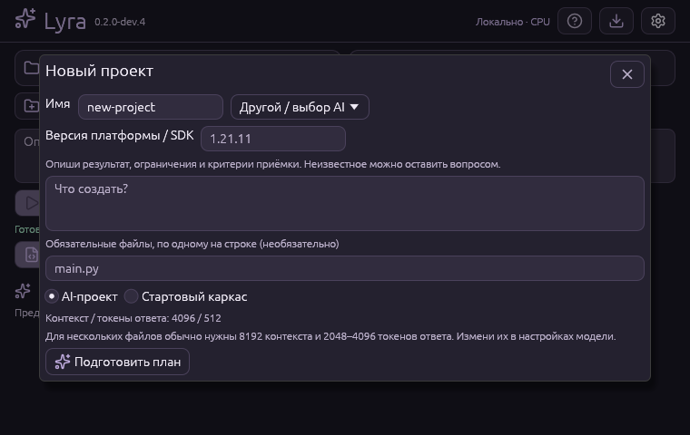

# Проекты с нуля · 0.2.0-dev.4

Lyra умеет подготовить универсальный AI blueprint, показать файлы и создать
**только новую папку** после отдельного действия пользователя. Задачи не ограничены
Minecraft или DayZ. Профиль — подсказка о платформе, не обещание качества модели.
Для неизвестного стека выбери «Другой / выбор AI» и опиши ограничения.

## Из приложения

1. Выбери локальную GGUF на главной; для каркаса модель не нужна.
2. Нажми «Новый проект». Задай имя (`a-z`, цифры, `-`, `_`), цель, профиль и
   версию платформы/SDK. Родительская папка может содержать пробелы и кириллицу.
3. Выбери «AI-проект» или «Стартовый каркас». Каркас — минимальная основа,
   он не реализует произвольную задачу пользователя.
4. При необходимости перечисли обязательные пути: например `main.py` и
   `tests/test_main.py`. Программа проверяет их сама. Native grammar также
   фиксирует эти пути; при ошибке другого backend доступна ограниченная коррекция.
5. Подготовь план. Просмотри вопросы, допущения, требования, документацию и код.
   Если остались вопросы — дополни задание и подготовь новый план.
6. Выбери родительскую папку и нажми «Создать и открыть проект». Папка с таким
   именем не должна существовать, даже если она пустая. После создания можно
   продолжить обычную задачу на главной.

Для AI-плана нескольких файлов рекомендуются 8192 контекста и 2048–4096 токенов
ответа. Это не скрытая настройка: значения меняются пользователем в разделе
модели. Недостаток контекста, токенов или времени даёт ошибку без создания проекта.
Исследование документации и коррекция плана делят общий лимит вызовов (CLI 1–8,
по умолчанию 4). Модель и режим inference не подменяются.



## CLI

Все команды доступны также внутреннему GUI worker. Без `create` файлов проекта нет:

```powershell
# Надёжный каркас без LLM; stdout — blueprint JSON
.\lyra.exe project starter --name hello-cli --profile rust > plan.json

# Универсальный AI-план: требования находятся в UTF-8 TASK.md
.\lyra.exe project plan --name greeter --profile python --target-version 3.11 --task-file TASK.md --model 'D:\Models\model.gguf' --docs python-docs.json --require-file main.py --context 8192 --max-tokens 4096 > plan.json

# После просмотра всего плана — отдельное явное создание
.\lyra.exe project create --plan plan.json --parent 'D:\Новые проекты'

# Read-only контекст/подсказки, без компиляции/исполнения
.\lyra.exe project inspect --repo 'D:\Новые проекты\greeter'
```

Для перенаправления JSON используй PowerShell 7 (либо явную запись UTF-8 без BOM).
UTF-16-файл от старого PowerShell не является UTF-8 blueprint.

## Каркасы и контекст

| Профиль | Каркас / условия |
| --- | --- |
| Rust | Cargo CLI, edition 2024, minimum Rust 1.85, unit test, без зависимостей |
| Python | stdlib CLI + unittest, Python 3.11+ |
| TypeScript | Node.js 22.18+ native type stripping; тест Node, без npm-зависимостей; это не type-check |
| Paper/Spigot Java | Maven/JDK 21, API `provided`, plugin.yml и Main.java |
| Paper/Spigot Kotlin | Те же условия; Kotlin 2.4.21, stdlib включается в JAR через shade, лицензия в resources |
| DayZ Enforce | config.cpp/mod.cpp/scripts/3_Game, явно заданная версия; нужны DayZ Tools/SDK и игровой тест |
| Другие / Java / Kotlin / JavaScript / .NET | Универсальный AI blueprint; готовый каркас для каждого runtime не предполагается |

Minecraft-каркасы поддерживают 1.20.6–1.21.11 и требуют точную версию.
Официальные Paper docs для 26.x используют другой формат API-зависимостей и
JDK 25: для них нужен отдельный AI-план и точные источники. Нельзя просто заменить
номер в старом pom.xml. API SNAPSHOT старых версий не даёт воспроизводимую фиксацию
артефакта: перед production запиши реально разрешённую версию/хеш.

Контекст существующего проекта определяется по lyra.project.json и ограниченным
признакам manifest/исходников. Смешанный проект остаётся неоднозначным. Данные
репозитория не становятся доверенной политикой. Файлы DayZ `.c` не означают C/C++;
Enforce также не означает совместимость с API другой игры Bohemia.

## Новые файлы в существующем проекте

`task` может вернуть `propose_file` наряду с `propose_edit`. Это предложение:
исходники не меняются. `apply --index` отдельно создаёт новый файл, не заменяя
появившийся после предложения файл. Read-only исследователь/ревьюер не получают
право предлагать запись. Новые файлы — UTF-8, до 64 KiB, до 8 предложений и 256 KiB
общего бюджета. Пустой `__init__.py` разрешён. Ignore/secret/path guards сохраняются;
создание скрытых файлов этим инструментом ограничено прежней политикой workspace.

Публикация нового файла атомарно не перезаписывает цель через hard link:
поддерживается NTFS и обычные Unix FS. На FS без hard links операция безопасно
отклоняется; пустые созданные подкаталоги могут остаться. Не обещается multi-file
транзакция для серии `apply`. Отчёт v2 помечает создание и документацию; v1 с
обычными заменами остаётся читаемым.

## Что именно проверяется

Blueprint: схема/размеры, пути, Windows reserved names, повторы без учёта регистра,
конфликт «файл/каталог», обязательные файлы и незакрытые вопросы. До 32 файлов,
64 KiB каждый, 512 KiB содержимого, JSON до 768 KiB. Запрещены выход из папки,
`.git`, секретные/двоичные файлы и подмена служебных metadata-файлов.
При ошибке записи после эксклюзивного создания папки неполный проект остаётся
для проверки: программа не удаляет рекурсивно данные, добавленные другим процессом.

**Lyra не исполняет произвольный код проекта.** Сборка может выполнять build.rs,
Maven/Gradle plugins и иной код; OS sandbox ещё нет. Поэтому приложение сообщает
`compiled: false` и показывает ручные проверки. Встроенные каркасы отдельно
компилирует разработчик/CI через tools/verify_starters.py; это не доказывает
работоспособность произвольного AI-проекта или Minecraft/DayZ в игре.

Реальная 0.5B GGUF проверяется отдельно от детерминированных тестов движка.
Успешный однофайловый пример не доказывает качество 7B и равенство GPT 6.1 Sol.
Большой запрос может завершиться таймаутом/неполным JSON; в таком случае проект
не создаётся. Оптимизацию подтверждают тестами и измерениями, а не выбором Rust.
